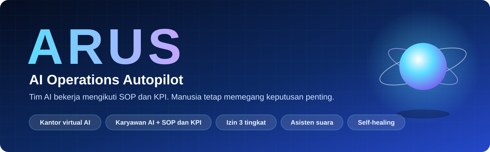
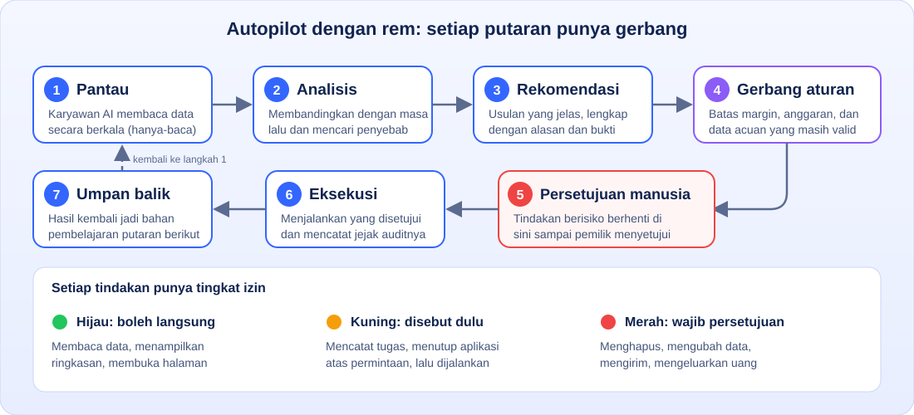
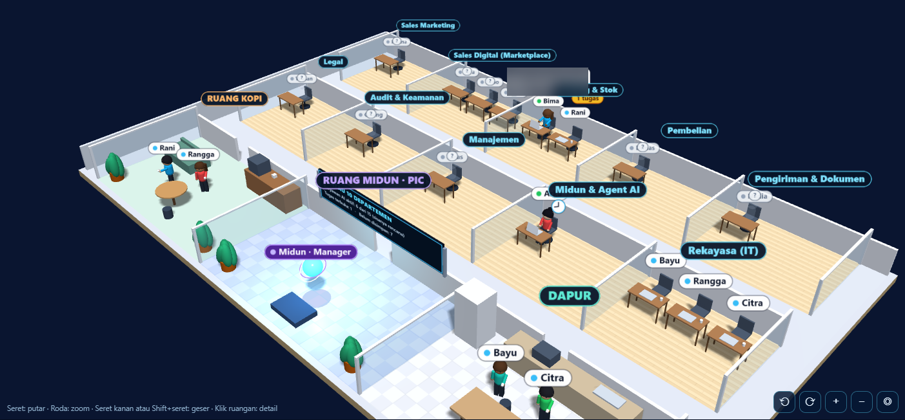
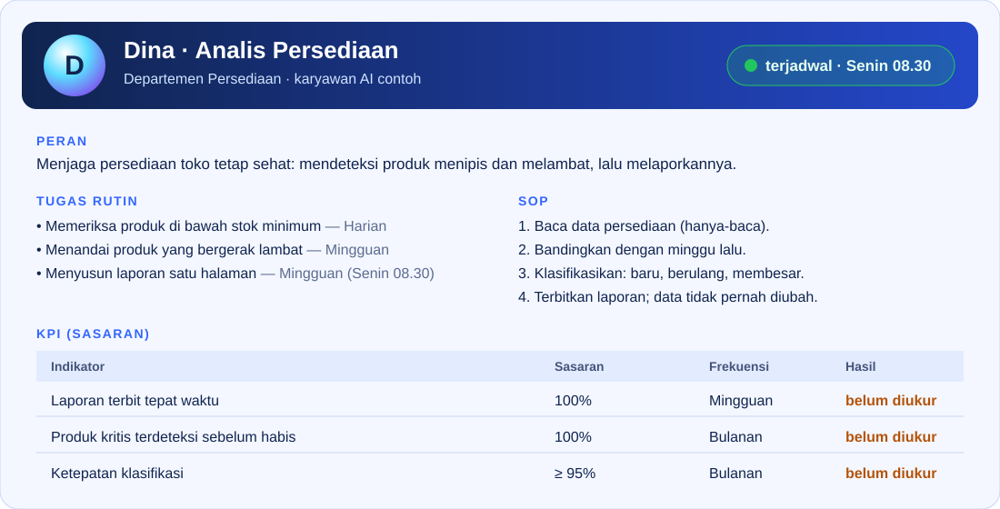

 

**Sistem autopilot kustom untuk operasional bisnis, dirancang mengikuti cara kerja Anda.**
ARUS adalah contoh hasilnya: tim AI bekerja mengikuti SOP dan KPI, memantau data, dan menyiapkan keputusan,
sementara manusia tetap memegang setiap keputusan penting.

 

 

[**Kenapa ARUS**](#kenapa-arus) · [**Cara kerja**](#cara-kerja-autopilot) · [**Fitur**](#fitur) · [**Keamanan**](#keamanan-dan-kontrol) · [**Demo**](#demo) · [**Cara kerja sama**](#cara-kerja-sama)

 

## Kenapa ARUS

Banyak bisnis kecil dan menengah masih dijalankan dari chat, spreadsheet, dan ingatan beberapa orang kunci.
Pertanyaan yang sama terus berulang, pekerjaan rutin memakan waktu, dan bisnis tersendat saat orang yang tahu sedang tidak ada.

Setiap bisnis punya cara kerja yang berbeda, jadi satu sistem jadi tidak akan pas untuk semua.
Karena itu pendekatannya: **sistemnya dirancang mengikuti bisnis Anda, bukan Anda yang mengikuti sistem.**

**ARUS** adalah contoh nyata pendekatan itu, sebuah sistem operasional yang membuat pekerjaan rutin berjalan sendiri.
Pola yang sama bisa disesuaikan dengan proses bisnis lain:

- **Tim AI dengan peran jelas.** Tiap "karyawan AI" punya tugas rutin, SOP, dan KPI tertulis, bukan sekadar chatbot.
- **Autopilot dengan rem.** AI menyiapkan dan menjalankan yang aman; hal sensitif selalu menunggu persetujuan manusia.
- **Bisa diajak bicara.** Tanya data dengan bahasa sehari-hari, lewat ketikan maupun suara.
- **Menjaga dirinya sendiri.** Bagian yang mati atau macet dipulihkan otomatis, dan semua tindakan tercatat.
- **Dibuat sesuai bisnis Anda.** Peran, SOP, aturan, dan sumber data disesuaikan dengan proses masing-masing pelanggan.

## Semua bisa disesuaikan

Yang Anda lihat di sini hanya contoh. Pada proyek pelanggan, hampir semua bagian dipilih mengikuti kebutuhan dan kenyamanan Anda:

| Bagian | Contoh pilihan |
|---|---|
| **Layanan AI** | Claude, Gemini, Grok, model lain, atau model yang dijalankan di komputer sendiri. Bebas, tidak terikat satu penyedia. |
| **Tempat data** | Google Sheets, Excel, database, atau sistem yang sudah Anda pakai |
| **Cara berinteraksi** | Ketik, suara, atau dashboard, sesuai yang paling nyaman bagi tim Anda |
| **Peran dan SOP** | Disusun dari proses kerja Anda sendiri, bukan template |
| **Batas izin** | Anda yang menentukan apa yang boleh jalan sendiri dan apa yang wajib disetujui |
| **Tempat berjalan** | Di akun dan perangkat Anda, bukan di tempat kami |

Kelayakan tiap pilihan dibahas di awal, sebelum pekerjaan dimulai.

## Cara kerja autopilot

1. **Pantau.** Karyawan AI membaca data bisnis secara berkala (hanya-baca).
2. **Analisis dan rekomendasi.** Temuan disusun menjadi usulan yang jelas, lengkap dengan alasan.
3. **Gerbang aturan.** Aturan bisnis (misalnya batas margin atau batas anggaran) memeriksa usulan sebelum diteruskan.
4. **Persetujuan manusia.** Tindakan berisiko berhenti di sini sampai pemilik menyetujui.
5. **Eksekusi dan umpan balik.** Hasilnya dicatat dan kembali menjadi bahan analisis berikutnya.

Antar-peran, pekerjaan diserahkan lewat **kartu serah terima** yang boleh ditolak bila kurang lengkap,
sehingga departemen bekerja berantai dan bukan sendiri-sendiri.

Pada contoh ARUS, rantai ini benar-benar **berjalan sendiri setiap Senin pagi**: belasan peran bekerja
bergiliran dari subuh (patroli kesehatan kode) sampai siang (strategi, gerbang margin, draf eksekusi),
dipimpin satu peran orkestrator yang membaca sasaran bisnis dan membagi tugas. Jam dua siang pemilik
menerima **satu lembar ringkasan**: hal yang menunggu keputusannya ada di paling atas.

## Fitur

| | |
|---|---|
| **Kantor virtual AI** | Denah kantor 3D yang bisa diputar, di-zoom, dan digeser. Tiap departemen punya ruang, tiap karyawan AI punya nama, tugas, dan keadaan nyata (ditugaskan, menunggu jadwal, siaga, atau belum direkrut). |
| **Karyawan AI dengan SOP dan KPI** | Peran, tugas rutin berfrekuensi, langkah SOP, dan KPI bersasaran. Hasil KPI hanya ditampilkan bila benar-benar terukur; selain itu tertulis jujur "belum diukur". |
| **Asisten suara yang natural** | Percakapan dua arah dengan bahasa Indonesia sehari-hari, bisa disela, dan bisa memakai alat (membaca data, membuka aplikasi dan berkas, mencatat tugas). |
| **Izin tiga tingkat** | Hijau jalan langsung, kuning disebut dulu, merah wajib persetujuan pemilik. Alat yang tidak dikenal otomatis dianggap merah. |
| **Alur kerja berantai** | Rantai tahap dengan kartu serah terima dan gerbang aturan, termasuk rumus penentu harga minimum agar penjualan tidak rugi. |
| **Rantai mingguan yang berjalan sendiri** | Belasan peran AI bekerja bergiliran tiap Senin pagi tanpa disuruh — dari patroli kode, audit log, audit stok, analisa penjualan, strategi, cek margin, sampai draf eksekusi — ditutup satu lembar ringkasan untuk pemilik. |
| **Setuju = aksi nyata** | Satu klik "Setuju" dari pemilik otomatis mengirim email tugas ke penanggung jawab manusia, lengkap dengan draf siap pakai. Draf follow-up pelanggan juga terkirim sendiri ke tim sales. Pemilik tidak pernah jadi kurir. |
| **Rekonsiliasi dari laporan resmi** | File laporan keuangan resmi marketplace tinggal diseret masuk (boleh beberapa sekaligus): biaya dan laba tercatat dikoreksi otomatis per pesanan memakai angka resmi, aman diulang, dan selisihnya dilaporkan. Tarif gerbang margin diverifikasi dari laporan yang sama — bukan tebakan. |
| **Penjaga otomatis** | Memantau server dan mikrofon, memulihkan yang mati atau macet, dengan batas supaya tidak berputar-putar dan lampu kesehatan yang jujur. |
| **Jejak audit** | Setiap pemakaian alat tercatat dengan tingkat izinnya, tanpa menyimpan isi percakapan sensitif. |
| **Tampilan jujur** | Hasil alat hanya menyatakan "sudah terbuka" atau "sudah ditutup" bila keadaan layar benar-benar terkonfirmasi. |

Sebagian fitur masih dalam pengembangan aktif (misalnya kunci suara pemilik dan penghubung ke akun toko online). Status tiap fitur dibahas terbuka di [docs/status.md](docs/status.md).

## Keamanan dan kontrol

- **Data bisnis tetap di akun Anda.** Pada contoh ARUS, data disimpan di Google Sheets dan Drive milik Anda, dan alat berjalan di laptop Anda. Perlu diketahui terbuka: apa pun layanan AI yang dipilih, pertanyaan yang dikirim ke asisten diproses oleh penyedia layanan itu (pada contoh ARUS, Gemini milik Google), jadi kebijakan privasi penyedia tersebut berlaku. Karena itu pemilihan layanan AI dibahas bersama di awal.
- **Rahasia tidak pernah ikut ke repositori.** Kunci API, sidik suara, dan data bisnis disimpan terpisah dari kode.
- **AI tidak membuka kata sandi.** Halaman kata sandi dan akun ditolak. Akses ke sistem pihak ketiga (misalnya akun toko online) dirancang lewat jalur resmi dengan izin baca saja, bukan dengan menyimpan kata sandi.
- **Tindakan berisiko selalu ada gerbangnya.** Menghapus, mengubah data, mengirim, dan mengeluarkan uang menunggu persetujuan.
- **Gagal aman.** Bila sesuatu tidak bisa dipastikan, sistem menolak atau meminta konfirmasi, bukan menebak.

Rincian: [docs/keamanan-dan-kontrol.md](docs/keamanan-dan-kontrol.md).

## Demo

Tangkapan layar kantor virtual dengan **data contoh** (karyawan dan tugas fiktif). Putar, zoom, dan geser dengan mouse.

Ilustrasi kartu karyawan AI dengan isi contoh.

Skenario penggunaan (fiktif, untuk gambaran): [docs/skenario-penggunaan.md](docs/skenario-penggunaan.md).

## Teknologi pada contoh ARUS

Google Apps Script · Google Sheets dan Drive · Gemini API (function calling dan Live API) · Node.js · Python ·
Three.js · Vosk (pengenalan kata panggil offline)

Ini pilihan untuk contoh ini saja. Proyek pelanggan memakai teknologi dan layanan AI yang paling cocok bagi mereka.

## Contoh kode

Folder [`examples/`](examples/) berisi potongan kode generik: penulisan data aman dengan kunci,
dan gerbang kualitas sebelum rilis. Tidak menyalin kode dari sistem mana pun.

## Cara kerja sama

Tertarik dibuatkan sistem autopilot untuk proses bisnis Anda? Alurnya sederhana:

1. **Cerita proses Anda.** Apa yang berulang, memakan waktu, atau sering terlewat. Belum perlu istilah teknis.
2. **Rancang bersama.** Kami menentukan peran, SOP, KPI, dan batas izin: apa yang boleh jalan sendiri dan apa yang wajib Anda setujui.
3. **Uji dengan data contoh.** Anda melihat hasilnya lebih dulu, tanpa risiko ke data asli.
4. **Pasang dan sesuaikan.** Dipasang di akun dan alat Anda sendiri, lalu disempurnakan dari pemakaian nyata.

Mulai dengan diskusi singkat tanpa kewajiban. Buka [Issue](https://github.com/RezaJakarta/ops-suite-showcase/issues) atau hubungi lewat
[profil GitHub](https://github.com/RezaJakarta). Lingkup, biaya, dan waktu dibahas per kasus dan disepakati tertulis sebelum mulai.

---

Dibuat oleh **Reza Ananda Putra** · [@RezaJakarta](https://github.com/RezaJakarta)

Seluruh nama, angka, dan tangkapan layar di repositori ini adalah contoh, bukan data nyata siapa pun.

## Lisensi

MIT. Lihat [LICENSE](LICENSE). Contoh kode boleh dipakai ulang dengan mencantumkan sumbernya.

English summary

Every business works differently, so I build custom autopilot systems around your own processes. **ARUS** is the working example:
a near-autopilot operations system where AI "employees" with written SOPs and KPIs
monitor your data, prepare decisions, and execute safe actions, while a three-tier permission model (green, yellow, red)
keeps humans in charge of anything sensitive. A dozen-plus AI roles run as a self-driving weekly chain — code patrol,
audits, sales analysis, strategy, a margin gate verified against official financial reports, and execution drafts —
ending in a one-page owner summary. One click of "Approve" emails the task, with a ready-to-use draft, straight to the
responsible human. It also includes a 3D virtual office, a natural Indonesian voice assistant, official-report
reconciliation that corrects recorded fees per order, self-healing supervision, and a full audit trail. The example uses Google Workspace,
Gemini, and Node.js, but custom builds are provider-agnostic: Claude, Gemini, Grok, other or local models, and your own
data stores. Open an issue to discuss a custom build for your business.

